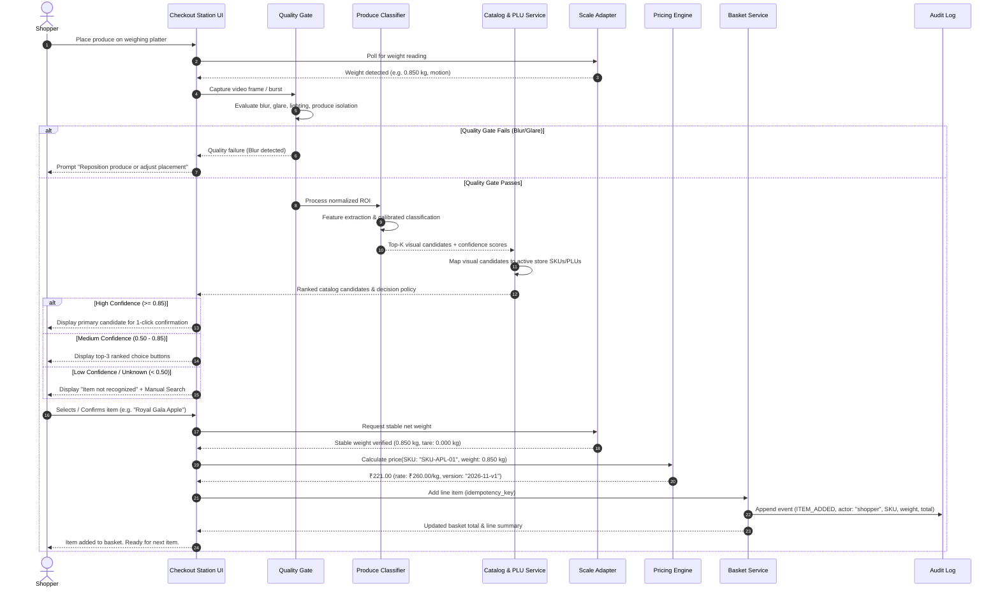

# Product Requirements Document (PRD)

# BarcodeLess Produce Assistant: Vision-Powered Assisted Checkout Platform

**Document Version:** 1.0.0  
**Effective Date:** 10 November 2026  
**Status:** Approved for Implementation & Pilot Validation  
**Product Lead:** Retail Workflow Engineering  
**Target Delivery:** MVP Pilot (Assisted Self-Checkout Station)

---

## 1. Executive Summary & Problem Definition

### 1.1 Context & Background
Loose produce (fruits and vegetables) represents one of the largest sources of friction and shrinkage in modern retail supermarkets. Unlike packaged consumer packaged goods (CPG) with GS1 standard EAN/UPC barcodes, fresh produce is sold by variable weight or piece count, requiring manual item lookups via Price Look-Up (PLU) codes or alphabetical menus on Point-of-Sale (POS) touchscreens.

### 1.2 Retail Problem Statement
1. **Checkout Friction & Long Queue Delays:** Shoppers and cashiers spend 15 to 45 seconds per produce item scrolling through hierarchical touch menus or memorizing hundreds of 4-to-5 digit PLU codes.
2. **Scan Avoidance & Cashier Mis-Keying (Shrink):** Under pressure, expensive varieties (e.g., Honeycrisp or Royal Gala apples at ₹260/kg) are frequently mis-keyed as cheaper conventional varieties (e.g., Shimla apples at ₹120/kg), causing severe inventory discrepancies and margin erosion.
3. **Ergonomic & Scale Desynchronization:** Traditional workflows require separate weighing stations or manual entry of scale readings, leading to manual transcription errors.

### 1.3 Proposed Solution: BarcodeLess Produce Assistant
A hardware-integrated computer-vision retail workflow platform that:
- Captures an overhead visual sample of produce placed on the checkout scale.
- Validates capture quality (blur, glare, occlusion, single-item focus).
- Predicts likely produce varieties with calibrated confidence scoring.
- Maps visual predictions directly to active store SKUs and PLU codes.
- Interfaces with certified digital scale hardware to capture net stable weight.
- Computes deterministic line item amounts using decimal-safe retail pricing rules.
- Adds validated items to the customer basket while maintaining an immutable audit log.

### 1.4 Core Product Principles
1. **Assistive, Not Autonomous:** The model *recommends*; the human *confirms*; the retailer's catalog and pricing engine *authoritatively decide*.
2. **Zero Financial Charges from Unreviewed AI:** No model prediction may unilaterally post an unreviewed financial charge to a payment method.
3. **Hardware Truth:** Weight measurements come strictly from approved physical scale hardware protocols, never from computer-vision volume or pixel estimation.
4. **Data Minimization & Privacy by Design:** Cameras point downward at the scale platter. No facial recognition, customer biometrics, or continuous surveillance footage is recorded.

---

## 2. User Personas & Customer Journeys

### 2.1 User Personas

| Persona | Role | Key Motivations | Primary Pain Points |
| :--- | :--- | :--- | :--- |
| **Priya (Shopper)** | Self-checkout consumer | Fast, painless checkout; transparency in item identification and price | Typing produce names, looking up obscure codes, waiting for attendants |
| **Ramesh (Cashier / Attendant)** | Lane operator / Assistant | Rapid verification, clear top-3 choices, instant manual search fallback | Memorizing 300+ PLUs, resolving shopper mis-identifications, long queues |
| **Anita (Store Manager)** | Store Operations & Inventory | Minimizing produce shrink, ensuring price compliance, equipment uptime | Inventory drift from mis-keyed produce, scale calibration failures |
| **Arun (Platform & ML Ops)** | ML Systems Engineer | High model reliability, low inference latency (<700ms), drift detection | Overconfident predictions, unseen seasonal varieties, camera lens smudges |
| **Officer Rao (Metrology Auditor)** | Legal Metrology Inspector | Compliance with Legal Metrology Act (2009), verified scale readings | Unverified digital modifications to legal weighing instrument readings |

### 2.2 End-to-End Assisted Checkout Workflow



---

## 3. Product Scope & Boundaries

### 3.1 MVP In-Scope Deliverables
1. **Assisted Checkout Kiosk Application:** Touchscreen-optimized interface supporting live camera capture, instant candidate review, scale status, basket management, and attendant mode.
2. **Store Operations & Admin Dashboard:** Web-based console for managing active store catalog, visual mappings, PLU codes, store-specific pricing, scale/camera device status, model registry, and audit event logs.
3. **Staged Vision & Quality Assessment Pipeline:**
   - Image Quality Gate (Laplacian blur variance, glare/overexposure ratio, underexposure, bounding box isolation).
   - Fine-Grained Produce Classifier trained on 25–40 primary supermarket produce classes.
   - Calibrated Confidence Scorer and Open-Set / Unknown Produce Rejection.
4. **Hardware Scale Abstraction Layer:**
   - Production scale protocol abstraction (continuous serial RS-232/USB communication, CAS/Mettler-Toledo command sets).
   - High-fidelity Legal-Metrology-compliant Scale Simulator with tare handling, jitter, motion/stability detection, and overload bounds.
5. **Deterministic Pricing Engine:**
   - 100% decimal-safe currency math (Python `decimal.Decimal` / exact integer cents).
   - Effective-dated store pricing with price lock versioning.
6. **Basket & Transaction State Machine:**
   - Idempotent line addition, quantity/weight adjustments, item deletion, and checkout settlement.
7. **Append-Only Audit Logging:**
   - Immutable audit trail capturing every recognition attempt, confirmation, attendant override, and line commit.

### 3.2 Explicitly Out-of-Scope (Non-Goals for MVP)
- General object recognition for boxed/barcoded grocery items.
- Autonomous unassisted checkout (charging a credit card without customer confirmation).
- Visual organic vs. conventional inference (forbidden by design; organic status must be selected explicitly or read from certified packaging/PLU).
- Visual fruit freshness, ripeness, or disease grading.
- Continuous shopper video surveillance or facial biometric tracking.
- Replacement or alteration of verified Legal Metrology scale firmware.

---

## 4. Functional Requirements (FR)

| ID | Requirement Name | Priority | Description & Acceptance Criteria |
| :--- | :--- | :--- | :--- |
| **FR-01** | **Camera Frame Capture** | **P0** | Capture high-resolution frames (min 720p) from connected USB/overhead camera or image stream upon motion trigger or button press. |
| **FR-02** | **Image Quality Assessment** | **P0** | Reject unusable images before model inference: compute Laplacian variance (blur < threshold), luminance distribution (glare > 15% pixels saturated, underexposure mean < 30). Return descriptive error prompt to UI. |
| **FR-03** | **Fine-Grained Classification** | **P0** | Classify produce items across supported pilot catalog classes with feature extraction and multi-class probability output. |
| **FR-04** | **Top-K Ranked Candidates** | **P0** | Return top-3 ranked candidate classes with calibrated probability scores and visual thumbnails. |
| **FR-05** | **Catalog & PLU Resolution** | **P0** | Map raw visual classes (e.g. `apple`) to store-specific active saleable SKUs (e.g. `SKU-APL-GALA`, `PLU 4133`) scoped by active `store_id`. |
| **FR-06** | **Confidence Decision Policy** | **P0** | Enforce 3-tier policy: High confidence (score ≥ 0.85) presents prominent single match; Medium confidence (0.50 ≤ score < 0.85) presents top-3 options; Low confidence (score < 0.50) triggers manual search fallback. |
| **FR-07** | **Verified Scale Integration** | **P0** | Read gross, tare, and net weights via scale adapter. Validate stability flag (`stable == true`), reject negative, zero, or overloaded weights for weight-priced items. |
| **FR-08** | **Authoritative Store Pricing** | **P0** | Retrieve active store price and unit basis (e.g., ₹/kg, ₹/piece) respecting effective date ranges. |
| **FR-09** | **Decimal Currency Arithmetic** | **P0** | Compute `line_total = round(net_weight * unit_price, 2)` using fixed-point decimal arithmetic (no IEEE-754 binary floating point precision errors). |
| **FR-10** | **Basket Line Management** | **P0** | Support adding items to basket, modifying line quantity, removing lines, and clearing basket. Require unique idempotency keys to prevent duplicate additions on retry. |
| **FR-11** | **Manual Catalog Search & Fallback** | **P0** | Provide responsive search modal allowing shoppers or cashiers to query produce items by name or 4-digit PLU code when recognition fails or item is unknown. |
| **FR-12** | **Attendant Escalation & Override** | **P0** | Cashier PIN-authorized modal to override price, apply tare override, or manually assign SKU with mandatory reason code logging. |
| **FR-13** | **Immutable Audit Logging** | **P0** | Persist append-only audit records for all transactions, recognition decisions, user confirmations, overrides, and device disconnects. |
| **FR-14** | **Hardware Health & Telemetry** | **P1** | Report liveness and readiness of camera, scale adapter, and backend services via `/health/live`, `/health/ready`, and `/api/v1/admin/devices`. |
| **FR-15** | **Model & Catalog Versioning** | **P1** | Track deployed model version (`model_version`), catalog version, and price version on every recognition and basket line record. |
| **FR-16** | **Operational Metrics & SLA Tracking** | **P1** | Export metrics for recognition latency (p50/p95), top-1 accuracy, manual override rate, unknown item rejection rate, and station uptime. |
| **FR-17** | **Store & Station Multi-Tenancy** | **P1** | All catalog mappings, prices, devices, and transactions are strictly scoped by `store_id` and `station_id`. |
| **FR-18** | **POS Integration & Receipt Generation** | **P1** | Generate structured POS payload and printable customer receipt summarizing lines, taxes, weights, price versions, and POS reference. |
| **FR-19** | **Offline Resilient Local Cache** | **P1** | Cache active store catalog and price snapshots locally to allow continuous operation during intermittent network drops. |
| **FR-20** | **Accessible & Multilingual UI** | **P2** | Responsive touch layout, large hit targets (min 48px), high contrast text, and support for multi-language display (English, Hindi). |

---

## 5. Non-Functional Requirements & Performance SLOs

| Dimension | Target SLO / Benchmark | Verification Method |
| :--- | :--- | :--- |
| **Inference Latency** | p95 < 300 ms on CPU, < 70 ms on edge accelerator | Automated benchmark suite running 500 representative test images |
| **End-to-End Latency** | p95 < 1.0 s from image capture to candidate display on UI | End-to-end integration test timing from capture request to DOM update |
| **System Availability** | 99.5% uptime during retail operating hours | Healthcheck probes and automated station reconnect |
| **Price Determinism** | 0.00% rounding or conversion discrepancy | Unit test matrix against 10,000 synthetic weight/price combinations |
| **Idempotency** | 100% duplicate basket line prevention under network retry | Idempotency test suite firing 10 duplicate line add calls in parallel |
| **Audit Immutability** | 100% tamper-evident event log retention | DB append-only permissions and checksum validation |
| **Scale Stability Tolerance** | Zero weight commits when scale motion flag is active | Scale adapter test verifying rejection of unstable readings |
| **Security & Privacy** | Zero customer facial data stored; TLS encryption in transit | Automated image sanitization checks; downward camera framing audit |

---

## 6. System Architecture & Component Design

```
+-----------------------------------------------------------------------------------+
|                            CHECKOUT STATION RUNTIME                               |
|                                                                                   |
|  +---------------------------+             +----------------------------------+   |
|  |   Overhead USB Camera     |             |   Digital Trade Scale (CAS/MT)   |   |
|  +-------------+-------------+             +-----------------+----------------+   |
|                | Video / Frame                               | RS-232 / USB       |
|                v                                             v                    |
|  +---------------------------+             +----------------------------------+   |
|  |   Image Quality Gate      |             |   Scale Protocol Adapter         |   |
|  |  (Blur, Glare, Isolation) |             |  (Tare, Stability, Net Weight)   |   |
|  +-------------+-------------+             +-----------------+----------------+   |
|                | Normalized ROI                              |                    |
|                v                                             | Net Weight (kg)    |
|  +---------------------------+                               |                    |
|  | Produce Classifier Engine |                               |                    |
|  | (Calibrated Top-K + Open) |                               |                    |
|  +-------------+-------------+                               |                    |
|                | Candidates & Confidence                     |                    |
|                v                                             v                    |
|  +----------------------------------------------------------------------------+   |
|  |                     Checkout Station UI & State Machine                    |   |
|  |           (High/Med/Low Decision Policy, Candidate Selection, Basket)       |   |
|  +-------------------------------------+--------------------------------------+   |
+----------------------------------------|------------------------------------------+
                                         | REST / WebSocket APIs
                                         v
+-----------------------------------------------------------------------------------+
|                               BACKEND CORE SERVICES                               |
|                                                                                   |
|  +---------------------+   +---------------------+   +------------------------+   |
|  |   Catalog Service   |   |   Pricing Engine    |   |   Basket & POS Service |   |
|  | (Store SKUs, PLUs)  |   | (Decimal Arithmetic)|   | (Idempotency, Orders)  |   |
|  +----------+----------+   +----------+----------+   +-----------+------------+   |
|             |                         |                          |                |
|             +-------------------------+--------------------------+                |
|                                       v                                           |
|                     +------------------------------------+                        |
|                     |     Audit & Telemetry Service      |                        |
|                     | (Append-Only Event Store, Metrics) |                        |
|                     +-----------------+------------------+                        |
|                                       v                                           |
|                     +------------------------------------+                        |
|                     |  Relational Store (SQLite/Postgres)|                        |
|                     +------------------------------------+                        |
+-----------------------------------------------------------------------------------+
```

---

## 7. Data Model & Database Schema

### 7.1 Entity Relationship Overview
The database enforces strict store scoping and price version tracking:

1. `stores`: Retail store locations with operational metadata and currency.
2. `stations`: Checkout counters or self-checkout kiosks linked to a store.
3. `devices`: Physical cameras, scales, and POS terminals associated with stations.
4. `catalog_items`: Authoritative store items (SKU, name, category, unit of sale: `kg` or `piece`).
5. `catalog_mappings`: Mappings linking visual classes (e.g. `Banana`, `Apple Red`) to specific `catalog_items` and voluntary IFPS PLU codes.
6. `prices`: Store-specific price master with effective date ranges, currency, and price version strings.
7. `recognitions`: Historical recognition attempts, top-K candidate JSON, chosen item, and confidence.
8. `scale_readings`: Weight sensor readings linked to recognition sessions.
9. `basket_lines`: Individual items in an active or committed checkout basket.
10. `transactions`: Customer checkout sessions with POS reference and settlement status.
11. `audit_events`: Append-only tamper-proof log of operational actions.
12. `model_versions`: Registry of deployed ML models with validation metrics.

---

## 8. REST API Specification

| Method | Endpoint | Description |
| :--- | :--- | :--- |
| `POST` | `/api/v1/recognitions` | Submit image payload (multipart/form or base64) to trigger quality check and produce classification. |
| `GET` | `/api/v1/recognitions/{id}` | Retrieve recognition result, candidate rankings, and decision policy. |
| `POST` | `/api/v1/recognitions/{id}/confirm` | Confirm candidate item or manual selection. |
| `GET` | `/api/v1/catalog/items` | Search store catalog by query, category, or PLU code. |
| `POST` | `/api/v1/scale/readings` | Fetch or submit scale reading from hardware/simulator. |
| `POST` | `/api/v1/scale/tare` | Zero or tare the active scale reading. |
| `GET` | `/api/v1/basket` | Retrieve active customer basket, subtotal, taxes, and lines. |
| `POST` | `/api/v1/basket/lines` | Add confirmed item with verified weight to active basket. |
| `PATCH` | `/api/v1/basket/lines/{id}` | Modify quantity or weight of an existing basket line. |
| `DELETE` | `/api/v1/basket/lines/{id}` | Remove a line item from the active basket. |
| `POST` | `/api/v1/basket/checkout` | Complete checkout, commit basket, generate POS receipt. |
| `GET` | `/api/v1/admin/devices` | Query health and telemetry of cameras, scales, and kiosks. |
| `GET` | `/api/v1/admin/metrics` | Retrieve operational metrics (latency, override rates, counts). |
| `GET` | `/api/v1/admin/audit` | Query immutable audit log with filters. |
| `GET` | `/health/live` | Process liveness probe. |
| `GET` | `/health/ready` | Dependency and hardware readiness probe. |

---

## 9. Regulatory, Legal Metrology & Privacy Compliance

### 9.1 India Legal Metrology Act (2009) & Packaging Rules
1. **Certified Weighing Instruments Only:** The platform interacts with digital scales via non-intrusive standard read-only protocols. The platform **never modifies scale calibration factors, internal metrological firmware, or raw division steps**.
2. **Clear Weight & Rate Visibility:** In accordance with Legal Metrology (General) Rules, the checkout screen prominently displays:
   - Measured Net Weight in kilograms (`kg`) to 3 decimal places (e.g. `0.850 kg`).
   - Active Unit Rate in Indian Rupees (e.g. `₹ 260.00 / kg`).
   - Exact Total Amount Payable (`₹ 221.00`).
   - Active Tare deduction if applicable.

### 9.2 Privacy & Data Minimization (DPDP Act)
1. **Camera Framing:** Cameras must be optically shielded and angled strictly toward the scale platter.
2. **Transient Processing:** Raw camera video is processed in station memory; non-training customer images are discarded immediately after recognition.
3. **No Biometrics:** No face detection, emotional analysis, or customer tracking is executed.

---

## 10. Acceptance Testing & Release Verification Gates

Before pilot deployment to a live retail lane, the release must satisfy:
1. **Vision Accuracy Gate:** Top-1 accuracy > 88% and Top-3 accuracy > 96% across all active pilot produce classes.
2. **Quality Gate Rejection:** 100% rejection of severely blurred (variance < 60) and blown-out glare images.
3. **Price Math Precision:** Zero deviation across all currency calculations.
4. **Scale Safety Gate:** 100% refusal to add weight-priced items when the scale reading is marked unstable, negative, or zero.
5. **Idempotency Gate:** Zero duplicate line items under repeated HTTP re-transmissions.
6. **Audit Traceability:** 100% of line additions, removals, and overrides recorded in `audit_events`.

---
*End of PRD*

