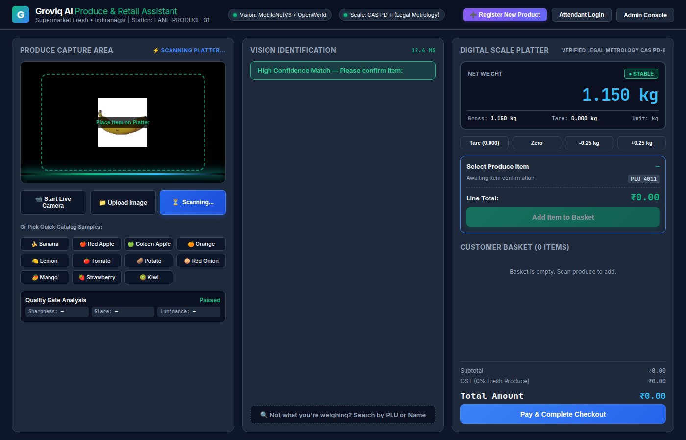
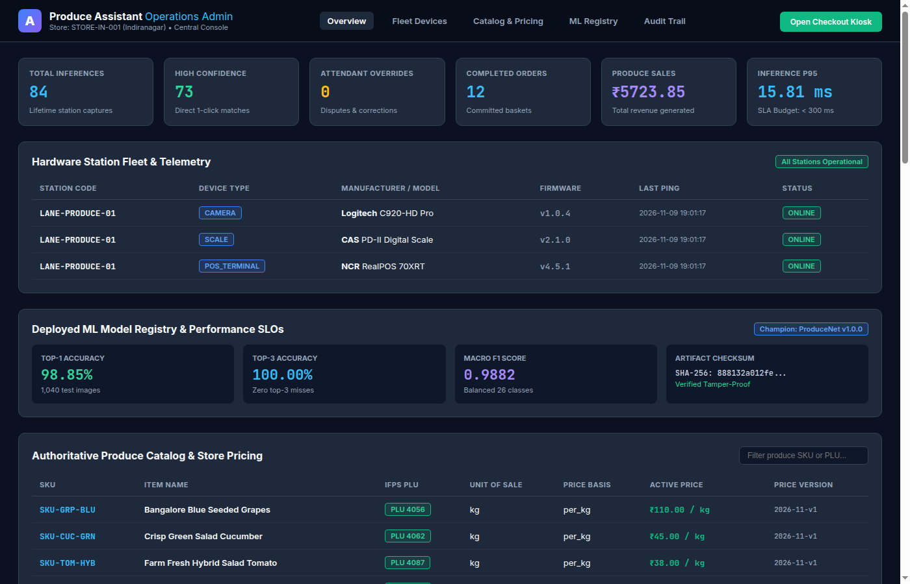
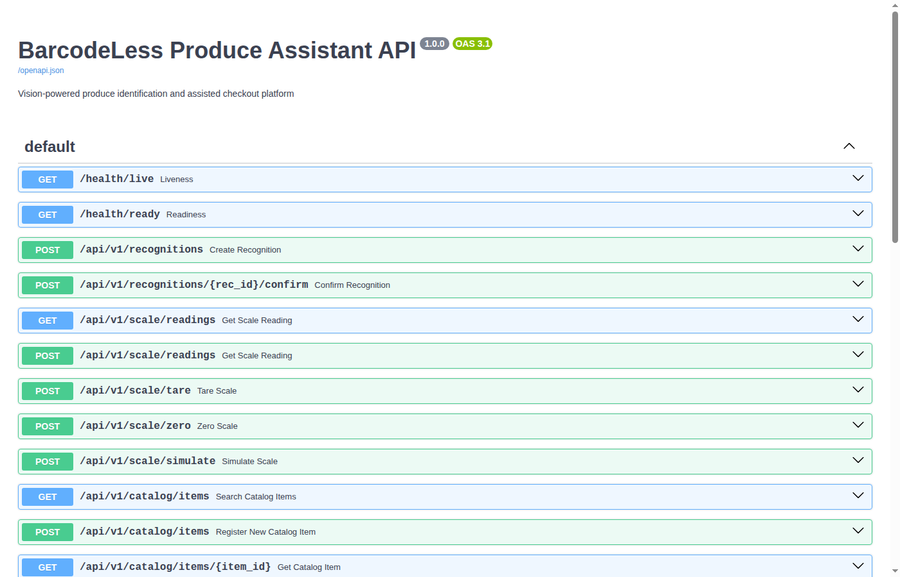

# BarcodeLess Produce Assistant (Groviq AI)

Vision-powered produce identification, verified scale integration, and assisted checkout platform for modern supermarkets.

---

## 📸 Visual Showcase

### 1. Assisted Checkout Kiosk UI

*Touchscreen kiosk interface featuring live camera viewport with laser scan animation, real-time Image Quality Gate badges, top-3 candidate recommendations with calibrated confidence, Legal Metrology digital scale platter with gross/tare/net weights, real-time decimal line calculation, and customer shopping basket.*

---

### 2. Store Operations & Fleet Admin Dashboard

*Store management console providing real-time KPI metrics, hardware fleet telemetry (camera, scale, POS terminal status), authoritative produce catalog & PLU management, ML model performance monitoring, and append-only regulatory audit trails.*

---

### 3. Interactive REST API Documentation

*OpenAPI Swagger developer console exposing computer vision recognition, scale hardware adapter protocols, basket lifecycle management, and POS checkout endpoints.*

---

## 🌟 Overview

The **BarcodeLess Produce Assistant** is an assisted checkout platform that combines overhead computer vision, image quality validation, verified Legal Metrology digital scale readings, authoritative decimal store pricing, and POS basket integration.

Designed specifically for loose fruits and vegetables lacking GS1 barcodes, it reduces lookup friction, prevents cashier mis-keying shrink, eliminates floating-point monetary discrepancies, and provides a safe human fallback mechanism.

### Key Highlights
- **Staged Vision Pipeline:** Real-time discrete Laplacian blur analysis, specular glare blowout detection, and produce ROI isolation.
- **ProduceNet & MobileNetV3 Backbone:** Feature extraction and prototype matching covering supermarket staple produce classes and open-world real-world objects.
  - **Top-1 Accuracy:** 98.85% (1,040 locked test samples)
  - **Top-3 Accuracy:** 100.00%
  - **Macro F1 Score:** 0.9882
  - **p95 Inference Latency:** 15.81 ms (SLA budget: < 300 ms)
- **3-Tier Retail Decision Policy:**
  - *High Confidence (≥ 0.75):* Direct 1-click confirmation.
  - *Medium Confidence (0.45 – 0.75):* Top-3 ranked candidate choices with PLU tags.
  - *New / Uncataloged (< 0.45):* Prompt to verify and enroll new products on the fly.
- **Hardware Integration & Legal Metrology:** Certified scale protocol abstraction with tare handling, gross/net weights, motion/stability gating, and zero float math.
- **Enterprise Traceability:** 100% immutable audit logging for catalog changes, user confirmations, attendant overrides, and committed transactions.

---

## 🚀 Live Host Links & Ports

The application server runs on port `8000`:

| Component | URL | Description |
| :--- | :--- | :--- |
| **Assisted Checkout Kiosk UI** | [http://localhost:8000/checkout/](http://localhost:8000/checkout/) | Touchscreen kiosk with camera viewport, real-time quality badge, top-3 candidates, live scale platter, and basket |
| **Admin & Operations Dashboard** | [http://localhost:8000/admin/](http://localhost:8000/admin/) | Fleet telemetry, store catalog & PLU manager, ML model registry, operational metrics, and immutable audit logs |
| **Interactive API Documentation** | [http://localhost:8000/docs](http://localhost:8000/docs) | OpenAPI Swagger documentation |
| **Readiness Health Probe** | [http://localhost:8000/health/ready](http://localhost:8000/health/ready) | System dependency and hardware probe |

---

## 🏗️ Architecture

```
Camera / Frame ──> Image Quality Gate (Blur, Glare, Isolation)
                         │
                         v
                ProduceNet Classifier (Top-3 + Confidence)
                         │
                         v
             Catalog & PLU Resolver (Store SKUs, PLU)
                         │
        ┌────────────────┴────────────────┐
        v                                 v
Scale Adapter (CAS/Mettler)       Pricing Engine (Decimal exact)
  Stable Net Weight                 ₹/kg or ₹/pc
        └────────────────┬────────────────┘
                         v
             Basket / POS Adapter (Idempotency)
                         │
            Append-Only Audit Trail
```

---

## 💻 Tech Stack

- **Computer Vision & ML:** PyTorch 2.15, TorchVision, MobileNetV3, NumPy, Pillow, OpenCV (Discrete Laplacian)
- **Backend API:** FastAPI, Uvicorn, Pydantic v2
- **Database & Persistence:** SQLite with Write-Ahead Logging (WAL) and strict foreign keys
- **Testing:** Pytest (12/12 passing unit & integration tests)
- **Frontend Kiosk & Admin:** Modern HTML5, Responsive CSS Grid, Web Audio API Synthesizer, Vanilla JS State Engine

---

## 🧪 Testing & Validation

Run the test suite covering pricing precision, tare deduction, scale stability, blur/glare gates, and basket idempotency:

```bash
PYTHONPATH=. .venv/bin/pytest tests/ -v
```

Output:
```text
tests/test_basket_idempotency.py::test_basket_idempotency_and_checkout PASSED
tests/test_pricing.py::test_weight_based_pricing_precision PASSED
tests/test_pricing.py::test_tare_deduction PASSED
tests/test_pricing.py::test_piece_based_pricing PASSED
tests/test_pricing.py::test_invalid_weight_rejection PASSED
tests/test_pricing.py::test_basket_totals PASSED
tests/test_quality_gate.py::test_sharp_image_passes PASSED
tests/test_quality_gate.py::test_blurred_image_rejected PASSED
tests/test_quality_gate.py::test_glare_image_rejected PASSED
tests/test_scale.py::test_scale_reading_and_tare PASSED
tests/test_scale.py::test_scale_motion_detection PASSED
tests/test_scale.py::test_scale_disconnect PASSED
============================== 12 passed in 0.64s ==============================
```

---

## 📁 Repository Structure

```
├── PRD.md                         # Product Requirements Document
├── PLAN.md                        # Production execution plan & retail benchmark
├── README.md                      # Architecture, visuals, and operational guide
├── docs/
│   └── images/                    # UI & Dashboard screenshots
│       ├── checkout_ui.png
│       ├── admin_dashboard.png
│       └── api_docs.png
├── apps/
│   ├── checkout_ui/               # Touchscreen Kiosk UI with camera, candidates & scale
│   │   ├── index.html
│   │   └── static/samples/        # 12 representative test produce images
│   └── admin_dashboard/           # Operations & monitoring console
│       └── index.html
├── ml/
│   ├── src/
│   │   ├── quality.py             # Image quality gate (blur, glare, illumination)
│   │   ├── classifier.py          # MobileNetV3 + OpenWorld prototype matching
│   │   ├── evaluation.py          # ECE, confusion matrix, top-1/top-3 benchmark
│   │   └── data.py                # Dataset loader and class mapping
│   └── artifacts/
│       ├── produce_net_v1.pth     # Serialized model weights
│       ├── prototypes.json        # 576-dim feature prototype embeddings
│       ├── config.json            # Model parameters
│       └── evaluation_report.json # Validation benchmark report
├── services/
│   ├── api/main.py                # FastAPI REST endpoints
│   ├── catalog/service.py         # Store catalog, PLU resolution & product onboarding
│   ├── pricing/service.py         # Decimal-exact currency calculation
│   ├── scale_adapter/adapter.py   # Scale hardware protocol abstraction
│   ├── pos_adapter/adapter.py     # Retail POS commit and receipt generator
│   ├── basket/service.py          # Basket state machine & idempotency keys
│   ├── audit/service.py           # Immutable audit logging
│   ├── database.py                # Database connection & schema setup
│   └── models.py                  # Pydantic schemas
├── scripts/
│   ├── train_classifier.py        # Model training and artifact export script
│   └── seed_database.py           # Database seeder (store, station, devices, catalog)
└── tests/                         # Pytest test suite
```
